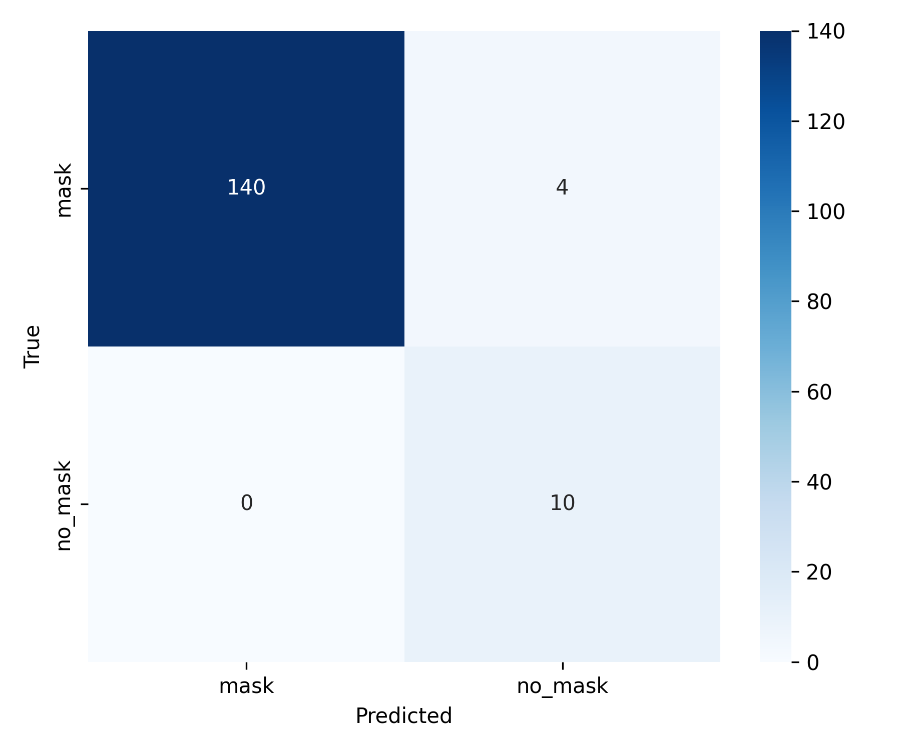
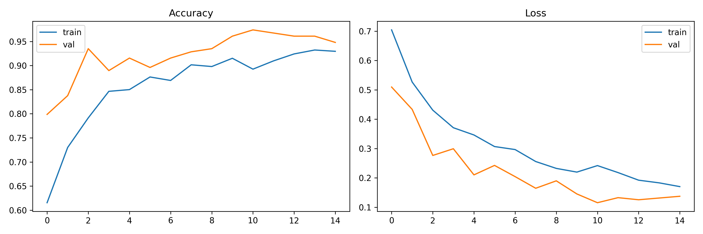

# Face Mask Detection with TensorFlow and OpenCV

University project by **Shady Nemat**, Technische Hochschule Deggendorf, Advanced Programming, January 2026.

A Python application that trains a mask/no-mask image classifier using MobileNetV2 transfer learning and applies it to webcam face crops detected by OpenCV. A separate React dashboard demonstrates an interface with simulated events; it is not connected to the Python detector.

## Contents

| Path | Purpose |
| --- | --- |
| training/train_tfdata.py | TensorFlow data loading, oversampling, augmentation, training, evaluation, and plots |
| detection/detect.py | Webcam capture, Haar face detection, and TensorFlow classification |
| model/mask_detector.h5 | Supplied HDF5 checkpoint, approximately 13.9 MB |
| model/class_indices.json | mask = 0, no_mask = 1 |
| model/training_history.png | Supplied accuracy/loss curves |
| model/confusion_matrix.png | Supplied confusion matrix |
| sort_dataset.py | Original annotation-to-folder helper; see limitations |
| client/, server/, shared/ | React/TypeScript simulated dashboard and Express scaffold |
| docs/poster-public.pdf | Academic poster with student ID removed |
| docs/verification.md | Inspection evidence, discrepancies, and execution limits |

Face datasets, annotations, virtual environments, and captured webcam images are excluded.

## Pipeline

Training loads 224 x 224 images with an 80/20 directory-based split and seed 42, oversamples minority classes within the training subset, and applies flipping, rotation, zoom, brightness, and contrast augmentation. Images are scaled to [0,1]. A frozen ImageNet MobileNetV2 backbone feeds global average pooling, dense layers of 256 and 128 units, dropout, and a softmax output. Adam starts at learning rate 0.0001.

Detection uses an OpenCV frontal-face Haar cascade, resizes face crops, converts BGR to RGB, and applies [0,1] normalization. It assigns mask only when mask probability is at least 0.80 and no lower than no-mask probability. Identity recognition is not implemented.

## Local setup

Choose a Python version supported by your TensorFlow release. Requirements are inferred from imports, unpinned, and untested; no original environment lockfile was supplied.

```sh
python -m venv .venv
```

Activate on Windows PowerShell:

```powershell
.\.venv\Scripts\Activate.ps1
```

Or on macOS/Linux:

```sh
source .venv/bin/activate
```

From the repository root:

```sh
python -m pip install -r requirements.txt
python detection/detect.py
```

The detector opens camera index 0 and an OpenCV desktop window. Press q to exit. Automatic debug-frame saving is removed in this public copy. Camera-reported FPS is a device property, not measured inference throughput.

**Verification limit:** Python syntax, class mapping, and the HDF5 file signature were checked. TensorFlow model loading, predictions, dependency installation, webcam operation, training, and web builds have not been tested during preparation.

## Training

Provide data you have permission to use:

```text
dataset/
  mask/
  no_mask/
```

```sh
python training/train_tfdata.py
```

Training may download ImageNet backbone weights and overwrites the checkpoint, mapping, and plots under model/. Back up supplied artifacts before retraining. The script runs up to 15 epochs. The saved checkpoint is selected by best validation accuracy, whereas early stopping restores weights using validation loss and evaluates that in-memory model. The saved checkpoint and plotted matrix may therefore represent different weights.

The original sorting helper outputs with_mask, without_mask, and mask_weared_incorrect, incompatible with the binary detector mapping. It copies entire images based only on the first XML object's label and does not crop faces. Review all annotations, create appropriate labeled crops, and handle the third class explicitly before training. Use subject/source-disjoint splits; the provided random file split does not enforce this.

## Supplied results



The supplied matrix is [[140,4],[0,10]], with actual classes on rows and predicted classes on columns:

| Metric | Calculated from the image |
| --- | --- |
| Samples | 154 |
| Accuracy | 150/154 = 97.40% |
| Mask recall | 140/144 = 97.22% |
| No-mask recall | 10/10 = 100% |
| No-mask precision | 10/14 = 71.43% |
| No-mask F1 | 20/24 = 83.33% |

These calculations are not a reproduced evaluation. It is unknown whether these are held-out images. Their totals match class counts in the poster, while the poster separately describes a different 34-image validation matrix. Raw predictions, split manifests, and numeric histories were not supplied. Ten no-mask examples do not establish generalization.



The supplied history shows 15 plotted epochs, unlike the [nine-epoch presentation illustration](docs/training_accuracy.png). Poster dataset totals, stopping claims, and 25–29 FPS claims remain unresolved. Read the [verification notes](docs/verification.md) before citing results.

## Optional dashboard

With Node.js 22.12+ and npm:

```sh
npm ci
npm run dev:client
```

Open the localhost address printed by Vite (configured port 5000). Webcam boxes, confidence values, events, and charts are random simulations. Settings do not invoke Python inference. Stock photos of uncertain provenance were replaced with an original neutral SVG, and simulation labels were added. Fonts load from Google Fonts. The frontend is untested during preparation; full-stack scripts use POSIX environment syntax and need adaptation for PowerShell.

## Known limitations

- MobileNetV2 preprocessing uses [0,1] consistently in this source rather than its standard preprocessing convention; changing it requires retraining and validation.
- Class weights are computed after equal-count oversampling, yielding equal weights.
- RandomRotation(0.2) allows roughly ±72 degrees, differing from the poster's ±20 degrees.
- Early-stopping patience is five in source, versus three in the poster.
- Camera FPS does not benchmark end-to-end inference.
- Saved checkpoint, evaluation weights, and plots need a documented common run identifier.

## Privacy and rights

Private datasets, webcam debug images, environments, and obvious secrets are excluded. The poster student-ID line is removed in a rasterized public copy; original academic claims remain intact and qualified here.

No new license is granted by this preparation. The dashboard package metadata says MIT, but no accompanying project license text was supplied. Confirm publishing rights for source, checkpoint, and poster; dependencies and institutional marks retain their respective terms. Dataset redistribution is outside this package.
